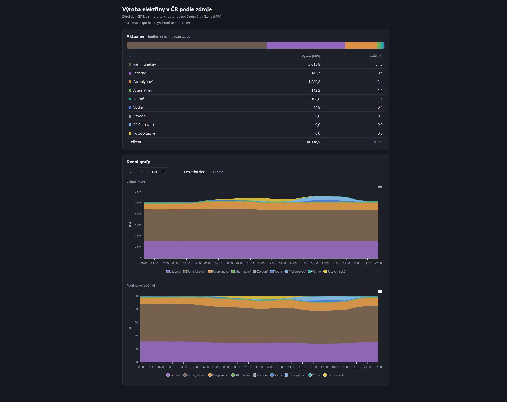

# cz-energy-generation

PHP dashboard výroby elektřiny v ČR podle typu zdroje (data ČEPS, a.s., hodinové průměry výkonu v MW):
aktuální výkon a podíly zdrojů a denní grafy.

Data se stahují ze služby ČEPS do SQLite databáze `data/ceps.sqlite`, která se vytvoří automaticky
(přístup k adresáři `data/` je zakázán přes `.htaccess`). Stačí PHP s PDO SQLite; grafy používají
ApexCharts a Chart.js ze složky `vendor/`.
